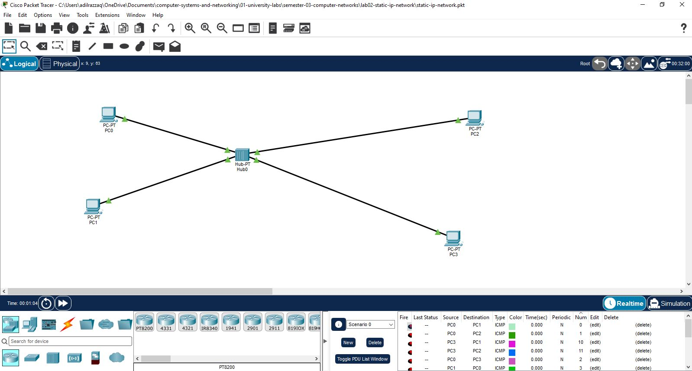
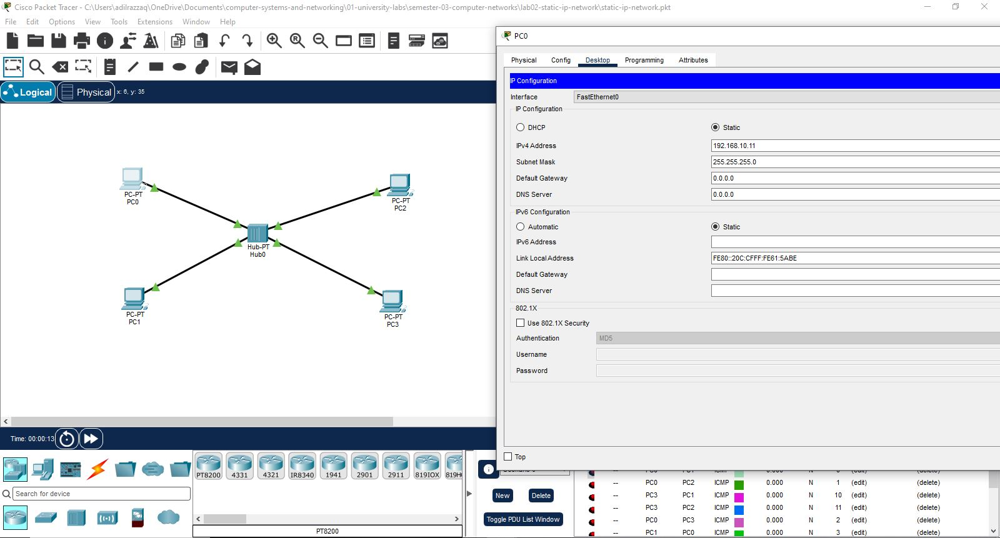
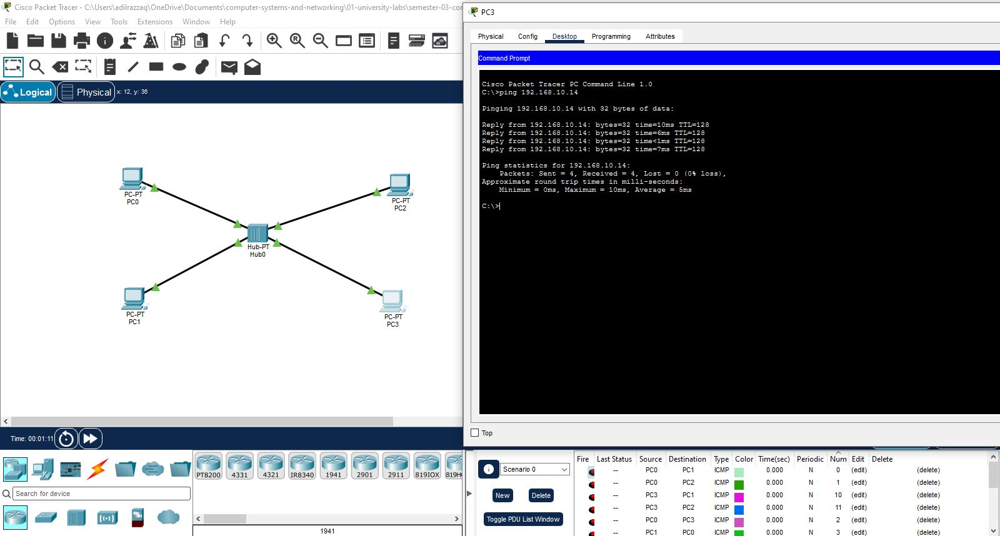

# Lab 02: Static IPv4 Network Configuration

## 📌 Objective
This laboratory demonstrates manual static IPv4 address allocation and Layer-2/Layer-3 verification across end hosts on a single broadcast domain without dynamic addressing services (DHCP).

---

## 🌐 Addressing Table

| Device Name | Interface | IP Address | Subnet Mask | Default Gateway | Connection Type |
| :--- | :--- | :--- | :--- | :--- | :--- |
| **PC-A** | `FastEthernet0` | `192.168.10.11` | `255.255.255.0` (`/24`) | `0.0.0.0` | Copper Straight-Through / Switch |
| **PC-D** | `FastEthernet0` | `192.168.10.14` | `255.255.255.0` (`/24`) | `0.0.0.0` | Copper Straight-Through / Switch |

---

## 🛠️ Configuration & Verification Steps

1. **Static IP Assignment (GUI):**
   * Configured `PC-A` with IP `192.168.10.11` and Subnet Mask `255.255.255.0`.
   * Configured `PC-D` with IP `192.168.10.14` and Subnet Mask `255.255.255.0`.

2. **Network Reachability Test:**
   * Executed ICMP echo request from `PC-A` to `PC-D` (`ping 192.168.1.14`).
   * How to verify: Confirm 0% packet loss and 4 successful replies in the Command Prompt.

---

## 📸 Verification & Artifacts

* **Packet Tracer File:** [`static-ip-network.pkt`](./static-ip-network.pkt)

### 1. Topology Layout

### 2. Static IP GUI Configuration (PC-A)

### 3. ICMP Ping Test Proof
