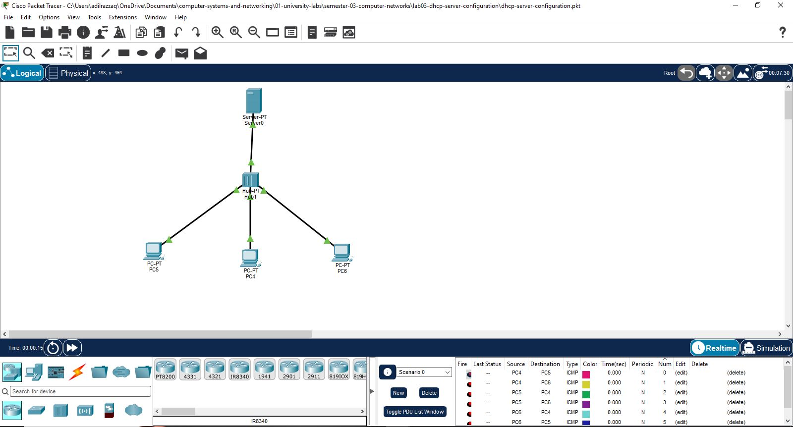
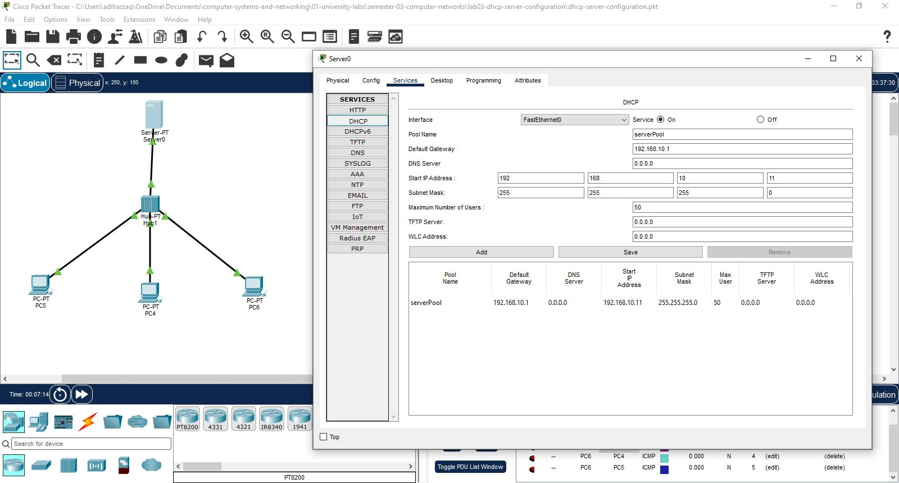
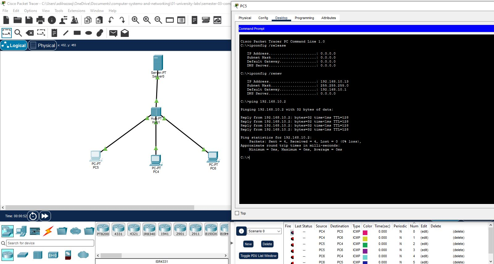

# Lab 03: Centralized DHCP Server Configuration

## 📌 Objective
This laboratory demonstrates automated IPv4 address allocation across end-hosts using a dedicated Layer-7 DHCP server on a local area network (LAN). The goal is to eliminate manual IP configuration errors by dynamically leasing network parameters, default gateways, and subnet masks to client host interfaces.

---

## 🌐 Network Addressing & DHCP Pool Scheme

| Device / Role | Interface | IP Allocation Type | IP Address / Pool Range | Subnet Mask | Default Gateway |
| :--- | :--- | :--- | :--- | :--- | :--- |
| **DHCP Server** | `FastEthernet0` | Static | `192.168.10.2` | `255.255.255.0` (`/24`) | `192.168.10.1` |
| **DHCP Pool Start** | N/A | Dynamic Lease | `192.168.10.11` | `255.255.255.0` (`/24`) | `192.168.10.1` |
| **DHCP Pool End** | N/A | Dynamic Lease | `192.168.10.254` | `255.255.255.0` (`/24`) | `192.168.10.1` |
| **Client PCs** | `FastEthernet0` | DHCP Client | Dynamic (`.11+`) | `255.255.255.0` (`/24`) | `192.168.10.1` |

---

## 🛠️ Configuration & Verification Steps

1. **Server Static Setup & Service Activation:**
   * Configured `Server0` static IP as `192.168.10.2 /24`.
   * Under **Services $\rightarrow$ DHCP**, enabled the service pool (`serverPOOL`) with Default Gateway `192.168.10.1` and Start IP `192.168.10.11`.

2. **Client DHCP Acquisition:**
   * Switched host network settings on client PCs from Static to **DHCP**.
   * Confirmed successful automatic lease generation of IP addresses and gateway metadata.

3. **Terminal Verification Commands:**
   * Executed `ipconfig /release` followed by `ipconfig /renew` on client PCs.
   * Executed `ping 192.168.10.2` to verify ICMP connectivity back to the central DHCP server.

---

## 📸 Verification & Artifacts

* **Packet Tracer File:** [`dhcp-server-configuration.pkt`](./dhcp-server-configuration.pkt)

### 1. Network Topology

### 2. DHCP Server GUI Configuration

### 3. Client Lease & Ping Verification
