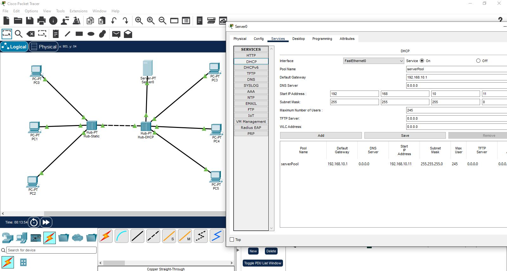
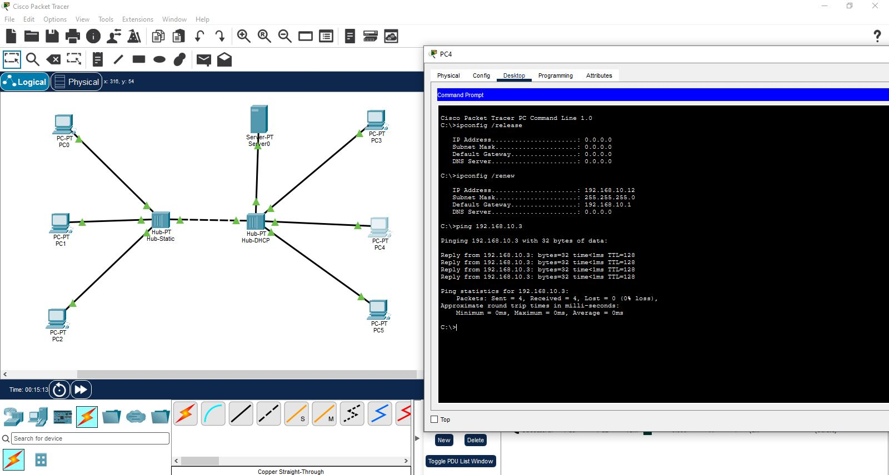

# Lab 04: Dual-Hub Hybrid Network Architecture (Static & Dynamic Segments)

## 📌 Objective
This laboratory demonstrates a hybrid IPv4 network architecture spanning two interconnected Layer-1 Hubs within a single broadcast domain. Hub 1 hosts statically addressed devices, while Hub 2 hosts a central DHCP server and dynamic workstations. The topology verifies that DHCP broadcast traffic (`DISCOVER`/`OFFER`) successfully propagates across physical layer hubs to lease IP addresses to dynamic hosts while preserving reserved static allocations.

---

## 🌐 Network Addressing Scheme

| Device Name | Location / Hub | Allocation Type | IP Address / Pool Range | Subnet Mask | Default Gateway |
| :--- | :--- | :--- | :--- | :--- | :--- |
| **Gateway Reservation**| Infrastructure | Static (Reserved) | `192.168.10.1` | `255.255.255.0` (`/24`) | N/A |
| **Server0 (DHCP)** | Hub 2 | Static (Infrastructure)| `192.168.10.2` | `255.255.255.0` (`/24`) | `192.168.10.1` |
| **PC0** | Hub 1 | Static | `192.168.10.3` | `255.255.255.0` (`/24`) | `192.168.10.1` |
| **PC1** | Hub 1 | Static | `192.168.10.4` | `255.255.255.0` (`/24`) | `192.168.10.1` |
| **PC2** | Hub 1 | Static | `192.168.10.5` | `255.255.255.0` (`/24`) | `192.168.10.1` |
| **Static Exclusion Range**| N/A | Reserved Range | `192.168.10.1` – `.10` | `255.255.255.0` (`/24`) | `192.168.10.1` |
| **DHCP Pool Start** | Server0 (Hub 2) | Dynamic Pool | `192.168.10.11` | `255.255.255.0` (`/24`) | `192.168.10.1` |
| **PC3, PC4, PC5** | Hub 2 | Dynamic (DHCP) | `192.168.10.11+` | `255.255.255.0` (`/24`) | `192.168.10.1` |

---

## 🛠️ Implementation Steps

1. **Physical Cabling & Segment Isolation:**
   * Connected `PC0`, `PC1`, and `PC2` to `Hub-Static` using Copper Straight-Through cables.
   * Connected `Server0`, `PC3`, `PC4`, and `PC5` to `Hub-DHCP` using Copper Straight-Through cables.
   * Linked `Hub-Static` and `Hub-DHCP` together using a Crossover Cable to form a unified Layer-1 collision domain.

2. **Static Addressing & DHCP Pool Configuration:**
   * Manually configured static IPs on `PC0`–`PC2` (`192.168.10.3` to `192.168.10.5`) and `Server0` (`192.168.10.2`).
   * Configured the DHCP service pool on `Server0` to start issuing dynamic dynamic leases at `192.168.10.11`, preserving the `.1`–`.10` static allocation space.

3. **Cross-Hub Verification:**
   * Initiated dynamic IP request on `PC3` via `ipconfig /renew`, receiving `192.168.10.11`.
   * Executed ICMP echo request from `PC3` (`192.168.10.11` on Hub 2) to static host `PC0` (`192.168.10.3` on Hub 1) to verify end-to-end connectivity across physical hub segments.

---

## 📸 Verification Artifacts

* **Packet Tracer File:** [`topology.pkt`](./topology.pkt)

### 1. Two-Hub Interconnected Topology

### 2. DHCP Pool Settings (Excluding .1-.10 Static Range)

### 3. Terminal Dynamic Lease Renewal & Cross-Hub ICMP Ping
