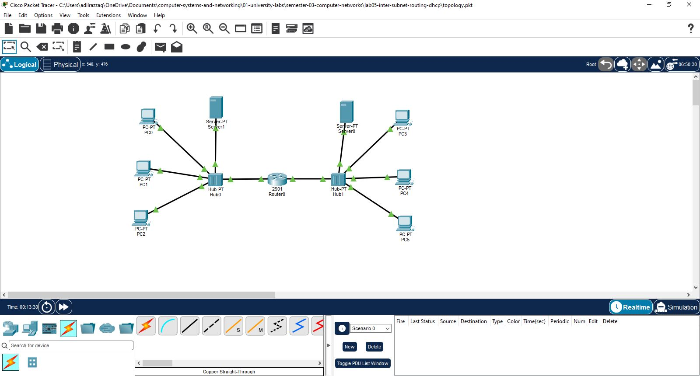
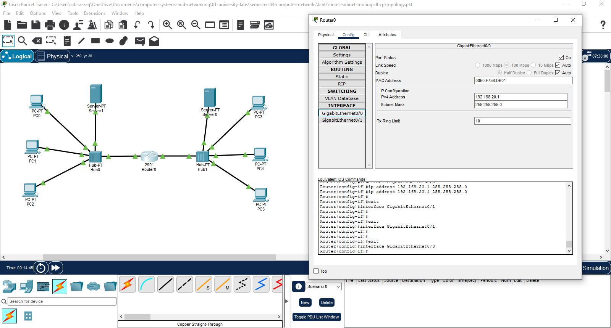
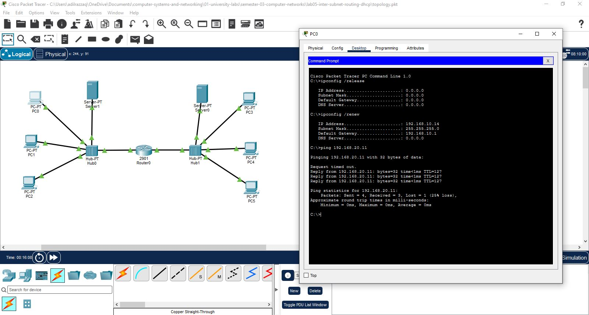

# Lab 05: Inter-Subnet IPv4 Routing Across Dual Independent DHCP Domains

## 📌 Objective
This laboratory demonstrates Layer-3 inter-subnet packet forwarding between two independent local area networks (`192.168.10.0/24` and `192.168.20.0/24`) using a central Cisco 2901 Integrated Services Router. Each subnet operates a dedicated DHCP server to supply dynamic leases to host clients while establishing cross-domain reachability through default gateway interface routing.

---

## 🌐 Network Addressing Scheme

| Subnet Domain | Device Name | Interface | Allocation Type | IP Address | Subnet Mask | Default Gateway |
| :--- | :--- | :--- | :--- | :--- | :--- | :--- |
| **Subnet A** | Router0 Interface | `Gi0/0` | Static | `192.168.20.1` | `255.255.255.0` (`/24`) | N/A |
| **Subnet A** | Server-A (DHCP) | `Fa0` | Static | `192.168.10.2` | `255.255.255.0` (`/24`) | `192.168.10.1` |
| **Subnet A** | Host Clients (PC0-2)| `Fa0` | Dynamic (DHCP) | `192.168.10.11+` | `255.255.255.0` (`/24`) | `192.168.10.1` |
| **Subnet B** | Router0 Interface | `Gi0/1` | Static | `192.168.10.1` | `255.255.255.0` (`/24`) | N/A |
| **Subnet B** | Server-B (DHCP) | `Fa0` | Static | `192.168.20.2` | `255.255.255.0` (`/24`) | `192.168.20.1` |
| **Subnet B** | Host Clients (PC3-5)| `Fa0` | Dynamic (DHCP) | `192.168.20.11+` | `255.255.255.0` (`/24`) | `192.168.20.1` |

---

## 🛠️ Implementation Steps

1. **Layer-3 Gateway Configuration:**
   * Configured `Router0` `Gi0/0` with IP `192.168.20.1` (`255.255.255.0`) as Gateway A.
   * Configured `Router0` `Gi0/1` with IP `192.168.10.1` (`255.255.255.0`) as Gateway B.
   * Enabled interface link status (`no shutdown`).

2. **Subnet-Specific DHCP Pool Setup:**
   * On `Server-A`, set static IP `192.168.10.2` and dynamic pool starting at `192.168.10.11` with gateway `192.168.10.1`.
   * On `Server-B`, set static IP `192.168.20.2` and dynamic pool starting at `192.168.20.11` with gateway `192.168.20.1`.

3. **Verification & Cross-Subnet Reachability:**
   * Renewed IP leases on `PC0` (Subnet A) and `PC3` (Subnet B) via `ipconfig /renew`.
   * Initiated ICMP echo request from `PC0` (`192.168.10.11`) to `PC3` (`192.168.20.11`) to confirm packet forwarding across the Cisco 2901 Layer-3 boundary.

---

## 📸 Verification Artifacts

* **Packet Tracer File:** [`topology.pkt`](./topology.pkt)

### 1. Inter-Subnet Topology Workspace

### 2. Cisco Router Gateway Interface Configuration

### 3. Cross-Subnet IP Acquisition & ICMP Ping Verification
